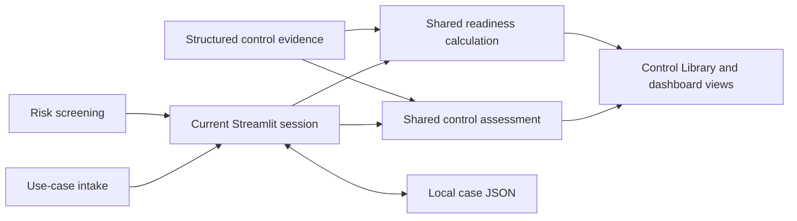

# Saudi Public Sector AI Governance Lab

A self-directed portfolio prototype showing how AI governance principles can be translated into practical use-case documentation, control assessments, evidence records and readiness reporting for a **simulated Saudi public-sector AI use case**.

The project is intended to demonstrate governance analysis and workflow design. It is not a live client implementation, production AI system or source of legal advice.

## 1. Project Overview and Purpose

The lab provides a small, interactive Streamlit application for exploring AI governance responsibilities across a use case's lifecycle. It brings together context intake, illustrative risk screening, accountability roles, structured governance assessments, local case persistence and executive reporting.

The NIST AI Risk Management Framework (AI RMF) is used as a conceptual reference for organising the prototype. The implementation does not claim conformity with NIST or any legal or regulatory framework.

## 2. Scope and Prototype Disclaimer

This is a portfolio case study in a simulated environment. It does not represent an organisation's approved governance framework, a legal compliance determination, regulatory approval, certification, or deployment authorization.

Assessment forms record proposed governance documentation. An **Available** evidence status means that the prototype's configured record is complete, marked Reviewed and explicitly saved where required. It does not prove that technical validation, monitoring, security testing, incident response, or any other activity has occurred in production.

Do not enter real citizen personal data, confidential information or operational incident details. Case files are stored as local JSON and are not an access-controlled evidence repository.

## 3. Demonstration Use Case: Citizen Request Prioritisation AI

The example use case is **Citizen Request Prioritisation AI**. It provides a recommended priority score for human review; it does not autonomously make the final operational decision. The intake captures the system's purpose, owner, users, affected people, data categories, output, AI role, human oversight, potential impact and incident-response considerations.

The example is illustrative. It does not describe a deployed Saudi public-sector system or claim that a model, dataset, performance level or operational process exists.

## 4. Implemented Features and Governance Workflow

- **AI Use Case Intake:** capture and save use-case context to the current Streamlit session.
- **Risk Assessment:** answer eight screening questions and calculate an illustrative score and Low/Medium/High tier using the prototype heuristic.
- **AI Inventory:** view the CSV baseline and show a matching current-session use case's risk tier when applicable. This is not a managed inventory service.
- **RACI Accountability Matrix:** edit a displayed RACI table and validate accountable-role counts. Editor changes are not currently persisted; `data/raci.csv` remains the baseline.
- **Control Library:** review catalogue controls and complete structured assessments for privacy/data (DAT-01), fairness (FAI-01), security (SEC-01), transparency (TRN-01), validation planning (VAL-01), monitoring planning (MON-01), and incident management planning (INC-01). Assessments use explicit save actions and canonical control evidence; loaded-case fields are hydrated back into the forms.
- **Deployment Readiness:** identify pending required pre-deployment controls and assess five operational requirements. The first four are derived from a complete, Reviewed, explicitly saved MON-01 assessment; incident response and escalation readiness is derived from INC-01.
- **Executive Governance Dashboard:** read-only overview of the current case, risk state, shared control assessments, MON-01/INC-01 operational readiness and deployment-readiness result.
- **Case Management:** save and load case documents locally as JSON, including across application restarts.

The prototype supports governance documentation and readiness review; it does not execute an approval decision or deploy an AI system.

## 5. Architecture and Repository Structure

```text
.
├── app.py                         # Streamlit navigation and case-management sidebar
├── views/                         # Intake, risk, inventory, RACI, controls and reports
├── src/governance/
│   ├── control_assessment.py      # Shared applicability and evidence-status logic
│   ├── deployment_readiness.py    # Shared readiness calculation
│   ├── case_persistence.py        # Case JSON validation, save/load and restoration
│   ├── risk.py                    # Illustrative risk heuristic
│   ├── framework.py               # NIST AI RMF functions and case-study principles
│   └── constants.py               # Pre-deployment blocker identifiers
├── data/
│   ├── controls.csv               # Control catalogue baseline
│   ├── ai_inventory.csv           # Inventory sample baseline
│   ├── raci.csv                   # RACI baseline
│   └── cases/                     # Local JSON case files
├── docs/                           # Portfolio summary
├── tests/                          # Unit, persistence, readiness and Streamlit tests
└── .github/workflows/              # GitHub Actions test workflow
```

At runtime, Streamlit pages read the current case from session state and use shared governance functions to determine control status and readiness. Case Management persists the canonical case data; the dashboard presents those shared results without creating a separate evidence or persistence model.



## 6. Conceptual Mapping to NIST AI RMF: GOVERN, MAP, MEASURE, MANAGE

The mapping below describes points of reference for the case study, not a formal NIST crosswalk or conformity assessment.

| NIST AI RMF function | Illustrative prototype relationship |
|---|---|
| **GOVERN** | RACI roles, named owners and reviewers, control catalogue, documentation and human oversight |
| **MAP** | Use-case purpose, intended users, affected people, data, AI role and potential impact |
| **MEASURE** | Illustrative risk screening and structured fairness, privacy, security and validation-planning records |
| **MANAGE** | Readiness blockers, monitoring and incident-response plans, escalation considerations and lifecycle control |

The app does not implement a formal NIST AI RMF subcategory mapping. The relationship is conceptual and should not be interpreted as evidence of framework alignment or compliance.

## 7. Governance Control Library

The control catalogue in `data/controls.csv` contains these controls:

| Control | Prototype focus |
|---|---|
| **GOV-01** | Accountability and registration, informed by the inventory and RACI baselines |
| **MAP-01** | Documenting use-case context |
| **DAT-01** | Structured privacy and data governance assessment |
| **FAI-01** | Structured fairness risk and mitigation assessment |
| **SEC-01** | Structured security assessment |
| **TRN-01** | Documenting purpose, AI role, limitations and transparency considerations |
| **VAL-01** | Acceptance criteria and intended-use validation planning |
| **MON-01** | Monitoring objectives, planned indicators, thresholds and responsibilities |
| **INC-01** | Incident definition, triage, escalation and response planning |
| **RET-01** | Lifecycle control for retirement or decommissioning; shown as Lifecycle / Not Due for initial readiness |

Structured assessments are governance records in this prototype. For DAT-01, FAI-01, SEC-01, TRN-01, VAL-01, MON-01 and INC-01, the configured fields must be complete and the assessment marked Reviewed before evidence becomes Available; explicit save actions store these records in canonical `control_evidence`. Applicability can depend on the use case or risk screening—for example, DAT-01 and FAI-01 use screening triggers.

An Available status is not a claim of completed production testing, performance validation, penetration testing, live monitoring, or actual incident handling. No test results or operational history are supplied by the application.

## 8. Evidence Status and Deployment Readiness Semantics

- **Required** identifies a control applicable under the prototype's existing rules.
- **Pending** means required evidence is absent or does not meet the configured assessment requirements.
- **Available** means the existing control logic recognizes sufficient evidence for that control. For structured assessments, that means complete fields, Reviewed status and explicit save.
- **Not required / Not Due** indicates that a control is not currently applicable under the prototype rules.
- **Lifecycle** identifies a control such as RET-01 that becomes relevant at a later lifecycle stage; it does not block initial deployment readiness.

Deployment readiness combines required pre-deployment controls with five operational requirements. A complete saved MON-01 plan satisfies the monitoring plan, metrics, thresholds and responsibilities requirements. A complete saved INC-01 plan satisfies incident response and escalation readiness. The readiness calculation does not treat the legacy readiness-plan booleans as substitutes for these control records.

The result **Ready for Deployment Approval** means only that the prototype found no configured pre-deployment blockers or incomplete operational requirements. It is not **Approved for Deployment**. Final deployment approval remains a human governance decision.

## 9. Local Case Save/Load and Data Handling

Use **Save Case** and **Load Case** in the application sidebar. Cases are written as JSON files under `data/cases/`, with a versioned case document containing:

- Use-case intake fields.
- The eight boolean risk-screening answers.
- The canonical `control_evidence` mapping, including explicitly saved structured control assessments.
- Deployment-readiness plan state included in the case format.
- Case ID, case name and save timestamp.

On load, risk results are recalculated from the saved screening answers and the saved control evidence is restored to the current session. Individual edits in the RACI editor are **not** included in case persistence; the RACI CSV remains the baseline. Inventory and control catalogue CSVs are repository data, not per-case copies.

Case JSON is stored locally without application-level encryption or access controls. Protect the workspace accordingly and use synthetic data only.

## 10. Installation and Run Instructions

Requirements: Python 3.12 is the version used by the repository's CI workflow. Dependencies are listed in `requirements.txt`.

### Windows (PowerShell)

```powershell
python -m venv .venv
.\.venv\Scripts\Activate.ps1
python -m pip install --upgrade pip
pip install -r requirements.txt
python -m streamlit run app.py
```

If PowerShell blocks virtual-environment activation, invoke the environment's interpreter directly:

```powershell
.\.venv\Scripts\python.exe -m pip install -r requirements.txt
.\.venv\Scripts\python.exe -m streamlit run app.py
```

### macOS / Linux

```bash
python3 -m venv .venv
source .venv/bin/activate
python -m pip install --upgrade pip
pip install -r requirements.txt
python -m streamlit run app.py
```

Streamlit prints a local URL when the app starts. No cloud deployment is configured or implied by these instructions.

## 11. Automated Tests and GitHub Actions CI

Install project dependencies, then run the complete test suite from the repository root:

```bash
python -m pytest -q
```

The tests cover the illustrative risk heuristic, control applicability and evidence status, case JSON validation and round-trip persistence, readiness rules, Streamlit page execution and dashboard behavior. GitHub Actions runs the tests on pushes and pull requests using Python 3.12 (`.github/workflows/python-app.yml`).

## 12. Portfolio Demonstration Walkthrough

1. Start the app and review the simulated Citizen Request Prioritisation AI intake.
2. Review the eight-factor risk screening and resulting illustrative tier.
3. Explore the inventory baseline and RACI matrix; note that RACI edits are not persisted.
4. Open the Control Library to review control applicability and, if desired, complete a structured assessment using synthetic information only.
5. Save the case, restart the app, and load it to demonstrate local JSON persistence and evidence restoration.
6. Review Deployment Readiness and the Executive Governance Dashboard. Show how MON-01 and INC-01 evidence contributes to readiness, and distinguish **Ready for Deployment Approval** from actual human approval.

Suggested portfolio description:

> Designed a self-directed AI governance prototype for a simulated public-sector use case, translating governance concepts into use-case intake, illustrative risk screening, accountability roles, structured control documentation, local case persistence and evidence-derived readiness reporting, with NIST AI RMF used as a conceptual reference.

## 13. Known Limitations and Future Improvements

- The risk score is an illustrative eight-factor weighted heuristic defined in `src/governance/risk.py`. NIST AI RMF does not prescribe it, and it is not an official NIST, Saudi government or SDAIA risk score.
- Use-case and assessment content is illustrative and user-entered. The repository does not establish factual performance, model behavior, dataset quality, fairness outcomes, security posture or operational effectiveness.
- There is no deployed AI model, production integration, live monitoring, tested incident-response operation, formal validation program, authentication, role-based access control or centralized evidence store.
- Readiness is a prototype workflow output, not legal or regulatory conformity, certification, risk acceptance or deployment approval.
- Case files are local JSON; RACI edits are not persisted, and inventory/RACI CSVs are baselines rather than controlled registries.
- The NIST AI RMF relationship is conceptual, not a formal subcategory crosswalk.

Potential future work includes controlled multi-user storage and access, versioned and auditable evidence records, configurable organization-approved risk methods, evidence provenance, and a formally reviewed mapping to applicable organizational and regulatory requirements. These are future possibilities, not implemented features.

## 14. Official References

- NIST, [Artificial Intelligence Risk Management Framework (AI RMF 1.0)](https://www.nist.gov/itl/ai-risk-management-framework)
- NIST, [AI RMF Playbook](https://airc.nist.gov/airmf-resources/playbook/)
- NIST, [AI RMF Resource Center](https://airc.nist.gov/airmf-resources/)
- OECD, [OECD AI Principles](https://www.oecd.org/en/topics/ai-principles.html)
